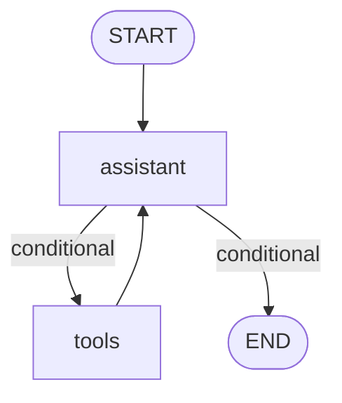

# Cohzen (`cz`)

**Cohzen** is a local-first toolkit that statically reconstructs, audits, and records LangGraph applications without runtime execution.

[](https://github.com/cohzenai/cohzen/actions/workflows/ci.yml)
[](https://pypi.org/project/cohzen/)
[](https://pypi.org/project/cohzen/)
[](LICENSE)
[](CONTRIBUTING.md#developer-certificate-of-origin-dco)

---

## ⚡ 30-Second Quickstart

```bash
# 1. Install Cohzen
pip install cohzen

# 2. Reconstruct your agent's architecture statically (zero execution)
cz scan .

# 3. Audit your observability and telemetry coverage
cz audit .
```

---

## 📸 What You Get

### 1. Terminal Architecture Flow & Scorecard (`cz scan .`)

Cohzen traverses your repository's AST, discovers LangGraph `StateGraph` workflows, links node handlers to LLM invocations and `@tool` bindings, and displays a crisp architecture report:

```text
╭───────────────────── Cohzen Architecture Scanner (v0.1) ─────────────────────╮
│                                                                              │
│  Scanned Target: ./my-langgraph-agent                                        │
│  Frameworks:     ✓ langgraph                                                 │
│  Files Examined: 4 total (3 Python files)                                    │
│  Scan Duration:  0.60 ms                                                     │
│                                                                              │
│  Graphs Detected: 1  • Compiled: 1  • Registered Nodes: 2  • Edges/Routes: 3 │
│  Node Handlers:   1  • LLM Call Sites: 1  • Tools Defined: 2  • ToolNodes: 1  │
│                                                                              │
╰──────────────────────────────────────────────────────────────────────────────╯
╭───────── Graph #1: builder (StateGraph) StateSchema: MessagesState ──────────╮
│ ✔ COMPILED -> variable: app at agent_tools.py:43                             │
╰───────────────────────────── agent_tools.py:31 ──────────────────────────────╯
╭───── 🌐 Architecture Flow (Nodes • Edges • Tools • Checkpointer • LLMs) ─────╮
│                                                                              │
│     ● START                                                                  │
│       │                                                                      │
│       ▼                                                                      │
│       ├── ? route: 'tools' ──► tools                                         │
│       ├── ? route: 'finish' ──►  ● END                                       │
│    ╔══ 🛠️ tools (ToolNode) ═══════════════════════════════╗                  │
│    ║  Tools: search_docs, calculate_metrics                                  │
│    ╚══════════════════════════════════════════════════════╝                  │
│    ┌── 🤖 tools (tool_node) ──────────────────────┐                          │
│    │  🧠 LLM: None (logic/router)                                            │
│    └───────────────────────────────────────────────────────┘                 │
│       └──► assistant                                                         │
│                                                                              │
╰──────────────────────────────────────────────────────────────────────────────╯
                          Registered Nodes & Handlers                           
┏━━━━━━━━━━━━━━┳━━━━━━━━━━━━━━━━━━━━┳━━━━━━━━━━━━━━━━━━━━┳━━━━━━━━━━━━━━━━━━━━━┓
┃ Node Name    ┃ Handler / Location ┃ LLM Calls & Models ┃ Tools Bound / Att.  ┃
┡━━━━━━━━━━━━━━╇━━━━━━━━━━━━━━━━━━━━╇━━━━━━━━━━━━━━━━━━━━╇━━━━━━━━━━━━━━━━━━━━━┩
│ 🤖 assistant │ assistant          │ langchain          │ bound: search_docs, │
│              │ (agent_tools.py:21)│ (model.invoke)     │ calculate_metrics   │
│ 🤖 tools     │ tool_node          │ Tool Execution     │ ToolNode(...)       │
│              │ (agent_tools.py:33)│                    │                     │
└──────────────┴────────────────────┴────────────────────┴─────────────────────┘
```

You can also export native Mermaid diagrams (`cz scan . --mermaid`) or launch the interactive browser visualizer (`cz view .`).

### 2. Automated Pull Request Architecture Gate

In CI/CD, Cohzen posts an automated scorecard directly on pull requests to prevent unmonitored agent drifts:

```markdown
### 🛡️ Cohzen Agent Architecture & Telemetry Audit

| Status | Metric | Value |
|:---:|:---|:---|
| 🟢 | **Architecture Scan** | 1 graph · 4 nodes · 5 edges |
| 🟢 | **Telemetry Coverage** | 100% (4/4 nodes instrumented) |
| 🔍 | **Active Tracers** | LangSmith (`LANGCHAIN_TRACING_V2=true`) |
| ⚠️ | **Checkpointer** | MemorySaver (In-memory only — state lost on restart) |

<details>
<summary>🗺️ View Mermaid Architecture Flow</summary>


</details>
```

---

## 🚀 Installation

Install Cohzen via `pip`, `uv`, or `pipx`:

```bash
# Using pip
pip install cohzen

# Using uv
uv add cohzen

# As an isolated global CLI with pipx
pipx install cohzen
```

*Note: Once installed, both `cz` and `cohzen` command aliases are available in your terminal.*

---

## 🔍 CLI Commands

| Command | Domain | Description |
|---|---|---|
| **`cz scan [path]`** | **Architecture Discovery** | Reconstructs graphs, nodes, edges, models, tools, and checkpointer persistence. Emits terminal flow or **`CohzenManifest`** JSON. |
| **`cz audit [path]`** | **Observability Audit** | Audits telemetry packages, `.env` configurations, and node-by-node / tool-by-tool instrumentation attribution. |
| **`cz view [path]`** | **Visualization Shortcut** | Convenience alias for `cz scan --view` to launch the interactive browser visualizer. |
| **`cz init [path]`** | **Always-On Setup** | Enables always-on local capture: creates configuration, telemetry DB, manifest, gitignore entry, and installs an isolated startup hook. |
| **`cz status [path]`** | **Capture Status** | Inspects effective capture settings, project marker, startup hook status, and retention limits. |
| **`cz on [path]` / `cz off [path]`** | **Capture Toggle** | Enables or disables always-on capture in `.cohzen/config.toml` without uninstalling hooks. |
| **`cz deinit [path]`** | **Project Teardown** | Reverts initialization: removes startup hooks, configuration, gitignore entries, and optionally retains `executions.db` (`--keep-data`). |
| **`cz capture -- <command>`** | **One-Off Capture** | Runs the supplied command with Cohzen capture enabled only for that single execution. |
| **`cz runs [path]` / `cz run <id>`** | **Runtime Records** | Lists local execution records or displays one record's hierarchical spans and timings. |
| **`cz version`** | **System Info** | Displays the installed `cz` release version. |

For detailed flags and subcommands, run `cz --help` or `cz <command> --help`.

---

## 🛡️ GitHub Action Usage

Enforce architecture hygiene and telemetry coverage in CI/CD by adding the official composite action to your repository's workflow (`.github/workflows/agent-gate.yml`):

```yaml
name: Agent Architecture Gate

on:
  pull_request:
    branches: [main]

jobs:
  cohzen-gate:
    runs-on: ubuntu-latest
    permissions:
      contents: read
      pull-requests: write # Required if comment-pr is true
    steps:
      - uses: actions/checkout@v4
      - uses: actions/setup-python@v5
        with:
          python-version: "3.11"
      - run: pip install cohzen

      - name: Cohzen Agent Architecture & Telemetry Gate
        uses: cohzenai/cohzen@v0.3.0
        with:
          path: "."
          min-coverage: "80"
          fail-on-missing-telemetry: "true"
          comment-pr: "true"
```

See the complete [CI/CD Integration Guide](docs/ci-cd.md) for full action inputs, outputs, and multi-directory examples.

---

## 🧩 Support Matrix

Cohzen is continuously tested across the following matrix:

| Component | Supported Range | Verified Versions | Notes |
|---|---:|---:|---|
| **Python** | `>=3.10` | 3.10, 3.11, 3.12, 3.13 | Native AST parsing across all language versions. |
| **LangGraph** | `>=0.2,<1.3` | 0.2.76, 1.0.10, 1.1.10, 1.2.16 | `StateGraph`, `Graph`, `MessageGraph`, `ToolNode`, compiled graph hooks. |
| **LangChain Core** | `>=0.2,<1.7` | 1.6.6 | Safe copy-on-write callback propagation. |
| **OpenTelemetry API** | `>=1.20,<2.0` | 1.45.0 | Telemetry auditing and attribute detection. |

See [docs/supported-frameworks.md](docs/supported-frameworks.md) for the complete list of supported LLM detectors (OpenAI, Anthropic, Google, Groq, Grok, LiteLLM) and observability providers (LangSmith, Langfuse, Arize Phoenix, Traceloop, AgentOps, W&B Weave).

---

## 🔒 Privacy & Data Handling

Cohzen is built on strict **local-first** and **zero-egress** principles:

1. **Zero Network Egress**: Cohzen never transmits source code, prompts, state values, or execution data across the network. All static analysis, manifest generation, and runtime capture occur purely on your local machine.
2. **Local SQLite Storage**: When local capture is enabled (`cz init` or `cz capture`), runtime records are stored in a local SQLite database (`.cohzen/executions.db`) that is automatically added to your `.gitignore`.
3. **Automatic Secret Redaction**: Before runtime payloads are committed to SQLite, Cohzen runs sensitive keys through a redaction processor that scrubs passwords, API keys, bearer tokens, private keys, and credential patterns (AWS, OpenAI, GitHub, Anthropic).
4. **Configurable Retention**: Control data volume via `.cohzen/config.toml` with strict caps on payload size (`max_payload_bytes`), run history (`max_runs`), and age (`max_age_days`).
5. **Fail-Open Architecture**: Runtime hooks fail open: if any capture error or database write occurs, your application execution continues unaffected without raising exceptions.

See [SECURITY.md](SECURITY.md) for our full security and vulnerability disclosure policy.

---

## ⚠️ Limitations & Honest Boundaries

To maintain trust and predictability, here is what Cohzen does **not** do:

* **Static AST Limitations**: `cz scan` inspects source code without importing or executing it. It cannot resolve dynamically constructed node names (e.g. `graph.add_node(eval(var))`), graphs assembled from remote network responses, or runtime metaprogramming.
* **LangGraph Focus**: Static scanning is currently optimized for LangGraph applications. Support for LlamaIndex Workflows, CrewAI, and AutoGen is in design and scheduled on our [ROADMAP.md](ROADMAP.md).
* **Local Development Capture**: The runtime capture engine is designed for local developer iteration, testing, and debugging. It is not intended as a multi-tenant, high-throughput production APM.
* **Manifest Stability**: `cz scan --json` emits the immutable **CohzenManifest v0.1** specification. Manifest schemas are strictly versioned (see [docs/manifest.md](docs/manifest.md)).

---

## 🧪 Testing

Cohzen maintains a rigorous test suite of unit tests, integration tests, runtime hooks, and real-world fixture projects:

```bash
# Run all 114 tests
pytest tests/ -v

# Run with test coverage (78% suite coverage)
pytest --cov=cz --cov-report=term-missing tests/
```

Includes 10 real-world architectural fixture projects under `tests/fixtures/real_world/` verifying single-file graphs, multi-module graphs, tool binding, conditional routing, subgraphs, and dynamic fallbacks.

---

## 🤝 Contributing & Maintenance Expectations

Cohzen is maintained by a solo builder part-time. 

* **Response Times**: Please expect replies to issues and pull request reviews within **48 to 72 hours**.
* **Contributing Guide**: We warmly welcome external contributions! Please read [CONTRIBUTING.md](CONTRIBUTING.md) for local environment setup, testing steps, and PR guidelines.
* **Adding Detectors**: Want to add support for a new LLM provider, tool pattern, or observability vendor? Check out our step-by-step guide in [docs/adding-a-detector.md](docs/adding-a-detector.md).
* **Developer Certificate of Origin (DCO)**: All commits must be signed off with `git commit -s`.
* **Code of Conduct**: This project adheres to the Contributor Covenant 2.1 ([CODE_OF_CONDUCT.md](CODE_OF_CONDUCT.md)).

---

## 📄 License

Cohzen is licensed under the **Apache License, Version 2.0**. See the [LICENSE](LICENSE) and [NOTICE](NOTICE) files for details.
