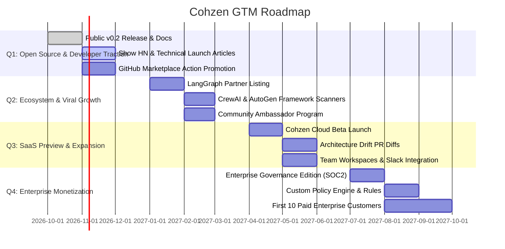

# Cohzen Go-To-Market (GTM) Strategy

## 1. Executive Summary

**Cohzen (`cz`)** is the architecture discovery, observability governance, and local telemetry platform purpose-built for AI agents and compound LLM systems.

While runtime tracing tools (LangSmith, Langfuse, Phoenix) capture *what happened during an execution*, they treat agent codebases as opaque black boxes until production traffic runs. Conversely, traditional static analysis tools (SonarQube, Snyk) are blind to agentic paradigms—such as cyclical graphs, tool-call routing, conditional branching, dynamic state transitions, and checkpoint persistence.

**Cohzen bridges this gap.** By reconstructing deterministic architecture directly from the AST with zero runtime overhead and enforcing observability gates in CI/CD, Cohzen provides the **"Shift-Left" layer for AI engineering**.

---

## 2. Market Problem & Opportunity

### The Problem
1. **Architectural Drift**: Complex multi-agent topologies (supervisors, hierarchical teams, subgraphs) mutate quickly across PRs with no living architectural documentation or automated change detection.
2. **Telemetry Blind Spots**: Developers frequently deploy agent nodes and tool integrations without tracing decorators, leading to silent failures and high MTTR in production.
3. **High Instrumentation Friction**: Developers resist complex manual telemetry setups during local prototyping, creating a disconnect between local iteration and production telemetry.
4. **Data Leakage Anxiety**: Teams fear sending sensitive internal state (credentials, customer PII, internal tokens) to hosted observability backends during local development.

### The Opportunity
As enterprise adoption shifts from single-prompt LLM wrappers to autonomous compound agent architectures (led by LangGraph, AutoGen, and CrewAI), engineering organizations require:
- **Automated topology visibility** without executing untrusted code.
- **CI/CD telemetry guardrails** ensuring 100% observability coverage before merging.
- **Fail-open, privacy-first local telemetry** that automatically captures graph runs and redacts secrets out of the box.

---

## 3. Ideal Customer Profile (ICP) & Buyer Personas

### Persona 1: The AI / Agent Engineer (End User & Champion)
- **Profile**: Software engineer or AI researcher building agentic workflows in LangGraph.
- **Pain Points**: Hard to debug multi-step routing; undocumented subgraphs; cumbersome tracing boilerplate; fears breaking state schema.
- **What Cohzen Gives Them**:
  - Instant visualization via `cz view` and Mermaid exports.
  - Zero-touch always-on local capture (`cz init`) that records runs to SQLite without changing application code.
  - Automatic secret redaction for peace of mind.

### Persona 2: The AI Platform Lead / Staff Architect (Technical Buyer)
- **Profile**: Lead architect establishing standard agent development practices across multiple squads.
- **Pain Points**: Inconsistent telemetry across repositories; architectural drift between design specs and merged code; unmonitored tools.
- **What Cohzen Gives Them**:
  - Deterministic system manifest (`CohzenManifest v0.1`).
  - Automated PR checks via `cz audit --min-coverage 80` to enforce company standards.
  - Living architecture catalogs across services.

### Persona 3: Head of AI / VP of Engineering (Economic Buyer)
- **Profile**: Executive accountable for AI reliability, compliance, budget, and time-to-market.
- **Pain Points**: Compliance risks from unredacted logs/traces; vendor lock-in; unmaintainable AI spaghetti code.
- **What Cohzen Gives Them**:
  - Vendor-neutral governance across all tracing backends (LangSmith, Langfuse, OpenTelemetry, Phoenix).
  - Reduced downtime and clear audit trails for agent architectures.

---

## 4. Value Proposition & Positioning

```text
┌────────────────────────────────────────────────────────────────────────┐
│                        COHZEN POSITIONING MATRIX                       │
├───────────────────┬────────────────────────────┬───────────────────────┤
│ Dimension         │ Runtime Tracing Tools      │ Cohzen (`cz`)         │
├───────────────────┼────────────────────────────┼───────────────────────┤
│ Phase             │ Shift-Right (Production)   │ Shift-Left (Code/CI)  │
│ Visibility Source │ Runtime Traces & Spans     │ Static AST + Runtime  │
│ Telemetry Health  │ Passive (discovers gaps    │ Active Enforcement    │
│                   │ after missing in prod)     │ (blocks PRs in CI)    │
│ Topology Source   │ Dynamically inferred       │ Deterministic Source  │
│                   │ from trace samples         │ Manifest from AST     │
│ Local DX          │ Cloud dashboard login,     │ Local SQLite, terminal│
│                   │ API keys, network egress   │ reports, web view     │
└───────────────────┴────────────────────────────┴───────────────────────┘
```

**Core Pitch**: *"Cohzen gives engineering teams complete visibility and governance over their AI agent architectures before they ever touch production."*

---

## 5. Product-Led Growth (PLG) Strategy

### Flywheel Motion

```text
           ┌──────────────────────────────────────┐
           │   1. Frictionless Developer Hook     │
           │  `pip install cohzen` / `cz scan`    │
           │  Instant ASCII flow & web visualizer │
           └──────────────────┬───────────────────┘
                              ▼
           ┌──────────────────────────────────────┐
           │    2. Local Always-On Productivity   │
           │  `cz init` -> Local SQLite capture   │
           │  Automatic secret redaction & logs   │
           └──────────────────┬───────────────────┘
                              ▼
           ┌──────────────────────────────────────┐
           │      3. Viral CI/CD Quality Gate     │
           │  Cohzen GitHub Action on Pull Request│
           │  Sticky PR comments with Mermaid flow│
           └──────────────────┬───────────────────┘
                              ▼
           ┌──────────────────────────────────────┐
           │     4. Team & Enterprise Expansion   │
           │  Multi-repo catalog, drift tracking, │
           │  cloud governance & policy engine    │
           └──────────────────────────────────────┘
```

### Motion 1: Single-Command Instant Gratification
Developers do not want to configure YAML or sign up for services to test a tool.
- `cz scan .`: Immediately displays the architecture of any LangGraph project in clean terminal ASCII.
- `cz view .`: One keypress launches a rich interactive visualizer in their local browser.

### Motion 2: The Sticky Pull Request Artifact
When a developer adds the Cohzen GitHub Action to their repository:
- Every Pull Request receives an automated comment containing:
  - Telemetry coverage score (`85% nodes covered`).
  - Rendered Mermaid diagram showing modified graph topologies.
  - Detected tools and LLM model bindings.
- **Viral impact**: Every reviewer and team member on the PR sees Cohzen in action, driving organizational adoption.

### Motion 3: Local Always-On Capture as Standard Dev Utility
- Running `cz init` installs a lightweight `.pth` hook in the virtual environment.
- Any local execution of the agent is automatically tracked to `.cohzen/executions.db` with zero configuration.
- Developers use `cz runs` and `cz run <id>` to inspect local executions, removing reliance on external cloud services during local development.

---

## 6. Distribution & Marketing Channels

### Phase 1: Developer Community & Organic Reach (Months 1–3)
- **GitHub / Open Source Ecosystem**:
  - Listing in LangGraph / LangChain ecosystem directories and awesome-langchain lists.
  - GitHub Action listed in GitHub Marketplace with tags: `ai`, `langgraph`, `agents`, `observability`, `ci-cd`.
- **Technical Content & Launch**:
  - Launch post on Hacker News ("Show HN: We built a static architecture scanner and CI gate for LangGraph").
  - Deep-dive technical articles on Substack/Medium:
    - *"Why Static Analysis is Necessary for AI Agents"*
    - *"How to Prevent Observability Regressions in LangGraph with GitHub Actions"*
    - *"Automating Multi-Agent Architecture Diagrams Directly from Code"*
- **Social & Community Channels**:
  - Short video demos on X (Twitter) and LinkedIn demonstrating `cz scan --view` on complex LangGraph architectures.
  - Active participation in Discord/Slack communities (LangChain, Latent Space, AI Engineers World's Fair, OpenTelemetry).

### Phase 2: Co-Marketing & Integration Partnerships (Months 3–6)
- **Observability Partner Integrations**:
  - Partner with Langfuse, Arize Phoenix, and AgentOps: Cohzen acts as the **CI/CD audit gate** ensuring their SDKs are correctly configured across all repositories.
  - Joint blog posts: *"Ensuring 100% Phoenix Tracing Coverage in LangGraph Pipelines with Cohzen"*.
- **Agent Framework Expansion**:
  - Expand static scanners and runtime hooks to AutoGen, CrewAI, and LlamaIndex Workflows.

### Phase 3: Enterprise & Commercial Pipeline (Months 6–12)
- Target Series B+ tech companies and enterprise innovation labs deploying AI agents to production.
- Outbound campaigns targeting Heads of AI Platform and Director of Platform Engineering.
- Offer free "AI Agent Architecture & Telemetry Health Audits" for qualified engineering teams.

---

## 7. Packaging & Monetization Model

### Open Source (Core CLI & Local Engine) — Free Forever
- `cz scan`, `cz audit`, `cz view`, `cz init`, `cz capture`, `cz runs`.
- Single-repository GitHub Action with Mermaid diagrams and local coverage checks.
- MIT Licensed. Zero telemetry phoning home.

### Cohzen Team (Cloud / Hosted SaaS) — $49 / engineer / month
- Centralized agent architecture registry across all organizational repositories.
- Architecture drift detection: Visual diffs showing exactly how agent topology changed between PR branches.
- Historical telemetry metrics and cross-repo audit reports.
- Slack / Discord / Microsoft Teams alerting on un-instrumented deployments.

### Cohzen Enterprise (Private Cloud / On-Premise) — Custom Annual Contract
- Self-hosted deployment (Docker, Kubernetes, AWS/GCP marketplace).
- Custom compliance and data-governance policies (e.g. blocking deployments with unredacted PII schemas).
- Single Sign-On (SAML/Okta), RBAC, and SOC2 compliance package.
- Dedicated engineering support, SLA, and custom framework detector plugins.

---

## 8. 12-Month Execution Roadmap



---

## 9. Key Performance Indicators (KPIs)

| Objective | Metric | 6-Month Target | 12-Month Target |
|---|---|---|---|
| **Developer Adoption** | GitHub Stars | 2,500+ | 8,000+ |
| | Monthly PyPI Downloads | 15,000+ | 75,000+ |
| | Weekly Active CLI Users | 1,000+ | 5,000+ |
| **Viral CI/CD Pipeline** | Active Repositories using GitHub Action | 200+ | 1,000+ |
| | Pull Requests Scanned per Month | 2,500+ | 15,000+ |
| **Commercial Conversion** | Team Beta Workspaces | 50+ | 250+ |
| | Enterprise Proof-of-Concepts (POCs) | 5 | 20 |
| | Annual Recurring Revenue (ARR) | $50K (Early pipeline) | $350K+ |

---

## 10. Summary & Immediate Next Steps

1. **Publish and Highlight**: Link this GTM roadmap in project documentation and README.
2. **Execute Community Launch**: Prepare the "Show HN" and technical launch post highlighting static architecture discovery and CI/CD quality gates.
3. **Register GitHub Action**: Complete GitHub Marketplace listing with clean iconography, documentation, and tags.
4. **Outreach to LangChain Ecosystem**: Submit Cohzen to the LangGraph ecosystem documentation as the recommended static architecture and governance tool.
